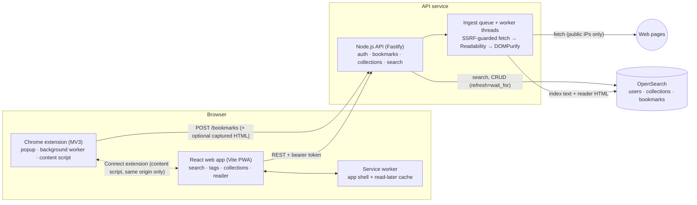

# LinkVault

[](https://github.com/temitopeagbola/LinkVault/actions/workflows/ci.yml)

A bookmark manager with full-text search: save any page from Chrome with one click, then find it again by what it
said — for people who save more links than they can remember titles for.

Production URL: **https://linkvault.temitopeagbola.com** (the web app, deployed by Netlify from `main`).

<p align="center">
  
</p>

| Offline reader (network disabled)                                                            | Mobile (375 px)                                                         |
| -------------------------------------------------------------------------------------------- | ----------------------------------------------------------------------- |
|  |  |

## Overview

Browser bookmarks only remember titles and URLs, so the article you half-remember is hard to find again. LinkVault
keeps the text. A Manifest V3 Chrome extension saves the current tab (with optional tags, collection and "read
later"); a Node.js API fetches the page behind an SSRF guard, extracts the readable article with Mozilla Readability
and indexes it in OpenSearch; and a React web app searches that full text with highlighted snippets, filters by tags
and collections, and keeps the reading list available offline through a service worker.

## Key features

- **One-click saving** from the Chrome extension: clicking the toolbar icon saves the tab immediately; the popup then
  adds tags, a collection or "read later", shows extraction progress and can undo. Right-click any page or link, or
  press <kbd>Alt</kbd>+<kbd>Shift</kbd>+<kbd>S</kbd>. Saving a URL from the web app works too.
- **Readable-text extraction**: the API fetches the page (or uses the HTML the extension captured for logged-in or
  JavaScript-heavy pages, which is opt-in), runs Readability on a script-less jsdom document in a worker thread and
  sanitizes the article with DOMPurify.
- **Full-text search** across titles, tags, URLs and page text: English stemming and stopwords, `"phrases"`,
  `-exclusions`, `prefix*`, field boosts, highlighted title and body snippets, tag facets, collection filters, sort and
  pagination.
- **Tags and collections**: AND-ed tag filters from the sidebar, facets or the cards; collections with colours;
  deleting a collection keeps its bookmarks (they move to Unsorted).
- **Read later, offline**: marking an article "read later" stores a copy in Cache Storage. A Workbox service worker
  precaches the app shell and serves the reader and the reading list with no network.
- **Idempotent saves**: URLs are normalized (tracking params, fragments, trailing slashes…), so saving the same page
  twice merges tags instead of creating a duplicate.
- **Accounts and demo**: email/password accounts, plus **Try the demo**, which gives every visitor a private, seeded
  sandbox that deletes itself after 24 hours.
- **Cold-start aware**: the web app and extension show a _"Waking up the server…"_ notice and retry idempotent requests
  while a sleeping API instance boots.
- Loading, empty and error states; responsive down to 375 px; labelled controls, visible focus rings, native
  `<dialog>` modals, a skip link and live regions.

## Tech stack

| Area             | Technology                                                                                                     |
| ---------------- | -------------------------------------------------------------------------------------------------------------- |
| Language         | TypeScript 5.9 (strict) on Node.js 22                                                                          |
| Web app          | React 19, React Router 7, TanStack Query 5, Tailwind CSS 4, Vite 7, `vite-plugin-pwa` + Workbox 7, DOMPurify   |
| API              | Fastify 5, Zod 4, `@fastify/rate-limit`, `@fastify/cors`, undici (fetching), jsdom + `@mozilla/readability`    |
| Search and data  | OpenSearch 2.x via `@opensearch-project/opensearch` (the only datastore); an in-memory store for tests and dev |
| Auth             | bcrypt (`bcryptjs`) password hashes, HS256 JWTs (`jose`) sent as bearer tokens                                 |
| Extension        | Chrome Manifest V3, React popup and options page, built with Vite                                              |
| Testing          | Vitest 4, Testing Library, Playwright 1.56                                                                     |
| Hosting (config) | Netlify (web app), Render free web service via Docker (API), Bonsai (OpenSearch), GitHub Releases (extension)  |
| Local stack      | Docker Compose: OpenSearch 2.17.1, the API, and the web app on nginx                                           |

## Architecture



**How a save flows:** `POST /bookmarks` normalizes the URL, derives a deterministic id from `(user, URL)`, stores the
bookmark as `pending` and returns immediately. An in-process queue fetches the page, extracts and sanitizes it in a
`worker_threads` pool (per-page timeout and heap limit), and updates the document to `ready` or `failed` with a
human-readable reason; the UI polls while anything is pending. The queue never runs two jobs for the same bookmark at
once, retries transient failures, re-reads the bookmark before writing so edits made meanwhile survive, resumes pending
jobs on boot and answers `429` when a user floods it.

**Data model:** OpenSearch is the only datastore, with three indices (`<prefix>-users`, `-collections`, `-bookmarks`).
Users use `sha256(email)` as document id so `op_type=create` is a race-free unique-email constraint; bookmarks use
`sha256(userId + normalizedUrl)` so saves are idempotent. Every query is scoped by `userId` inside the store layer. A
`Store` interface has two implementations — OpenSearch and an in-memory engine — and one contract test suite runs
against both.

**Search highlighting without XSS:** highlights use private-use Unicode characters as pre/post tags; the API converts
fragments to `{ text, highlight }` segments and the web app renders them as React nodes. Page HTML only reaches the
reader view, which is sanitized on the server and again in the browser.

## Project structure

| Path                 | What it holds                                                                                                   |
| -------------------- | --------------------------------------------------------------------------------------------------------------- |
| `apps/api`           | Fastify API: routes, OpenSearch and in-memory stores, ingest pipeline (fetcher, extractor, queue), demo seeding |
| `apps/web`           | React web app (PWA) with the custom service worker in `src/sw.ts`; `nginx.conf` for the Docker image            |
| `apps/extension`     | Chrome extension: popup, options page, background worker, content script, manifest generator, zip script        |
| `packages/shared`    | Zod schemas (`@linkvault/shared/schemas`), DTO types, URL normalization and tag parsing                         |
| `e2e`                | Playwright end-to-end test and the local fixture site it fetches from                                           |
| `docs`               | `PLAN.md` (design notes) and README screenshots                                                                 |
| `scripts`            | `render-icons.mjs`, which renders the logo to the PNG icon sizes                                                |
| `.github/workflows`  | CI and the extension release workflow                                                                           |
| `docker-compose.yml` | The full local stack                                                                                            |
| `render.yaml`        | Render Blueprint for the API                                                                                    |
| `netlify.toml`       | Netlify build, redirects and security headers for the web app                                                   |

## Getting started

### Prerequisites

- **Node.js 22.12 or newer** (`.nvmrc` pins 22; `package.json` requires `>=22.12`) and the npm 10 that ships with it.
- **Docker** with Compose, for OpenSearch or the full stack. Optional: without OpenSearch the API uses its in-memory
  store.
- **Google Chrome**, to load the extension.

### Install

```bash
npm install
```

### Environment

```bash
cp .env.example .env.local
```

`npm run dev` and `npm run seed` load the repo-root `.env` and then `.env.local`; shell variables override both. Every
variable is optional for local development. The `VITE_*` variables are read at build time from the environment (or a
`.env` file inside `apps/web` or `apps/extension`), not from the root files. Docker Compose sets its own values.

| Variable                                                           | Used by        | Purpose                                                                                                 |
| ------------------------------------------------------------------ | -------------- | ------------------------------------------------------------------------------------------------------- |
| `NODE_ENV`                                                         | API            | `development`, `test` or `production` (production requires `JWT_SECRET`).                               |
| `PORT`, `HOST`                                                     | API            | Port and interface to listen on (default `4000`, `0.0.0.0`).                                            |
| `LOG_LEVEL`                                                        | API            | Pino log level.                                                                                         |
| `TRUST_PROXY`                                                      | API            | Number of reverse proxies in front of the API, so rate limits see the real client IP.                   |
| `JWT_SECRET`, `JWT_TTL`                                            | API            | Token signing secret (32+ characters) and session lifetime (default `7d`).                              |
| `CORS_ORIGINS`, `ALLOW_EXTENSION_ORIGINS`                          | API            | Allowed web origins, and whether `chrome-extension://` origins may call the API.                        |
| `SEARCH_BACKEND`                                                   | API            | `opensearch` or `memory`; defaults to `opensearch` when `OPENSEARCH_URL` is set.                        |
| `OPENSEARCH_URL`, `OPENSEARCH_INDEX_PREFIX`, `OPENSEARCH_REPLICAS` | API            | Cluster URL (with credentials), index name prefix and replica count.                                    |
| `ALLOW_PRIVATE_FETCH`                                              | API            | Disables the SSRF guard so local pages can be fetched (dev/e2e only, never production).                 |
| `FETCH_TIMEOUT_MS`, `FETCH_MAX_BYTES`, `INGEST_CONCURRENCY`        | API            | Page fetch timeout and size cap, and the number of extraction workers.                                  |
| `DEMO_ENABLED`, `DEMO_TTL_HOURS`                                   | API            | "Try the demo" sandboxes on/off and their lifetime.                                                     |
| `SEED_LOCAL_DEMO_ACCOUNT`                                          | API            | Seeds the local account `demo@linkvault.local` on boot (dev only).                                      |
| `VITE_API_URL`                                                     | Web, extension | API base URL baked into the build.                                                                      |
| `VITE_EXTENSION_DOWNLOAD_URL`                                      | Web            | Where the settings page links to download the extension.                                                |
| `VITE_WEB_URL`, `VITE_EXTRA_WEB_ORIGINS`                           | Extension      | Web app URL baked into the extension, and extra origins its "Connect extension" content script runs on. |
| `OPENSEARCH_TEST_URL`, `E2E_OPENSEARCH_URL`                        | Tests          | Run the store contract tests / the e2e suite against a real OpenSearch.                                 |

### Local services

```bash
docker compose up -d opensearch   # OpenSearch on http://127.0.0.1:9200
```

Then set `OPENSEARCH_URL=http://localhost:9200` in `.env.local` to persist data. Without it the API runs on the
in-memory store and the UI shows a banner saying data resets on restart.

### Run

```bash
npm run dev    # API on http://localhost:4000, web app on http://localhost:5173
```

Click **Try the demo** for a seeded sandbox. To add the fixed local account (`demo@linkvault.local` /
`linkvault-demo`) to OpenSearch, run `npm run seed`.

### Run everything in Docker

```bash
docker compose up --build
```

| Service    | URL                               |
| ---------- | --------------------------------- |
| Web app    | http://localhost:8080             |
| API        | http://localhost:4000 (`/health`) |
| OpenSearch | http://127.0.0.1:9200             |

Compose seeds the local account above. Behind a TLS-intercepting proxy, pass its CA as the optional `npm_ca` build
secret (see the comment at the top of each Dockerfile).

### Load the extension

1. Build it:
   - Local:
     `VITE_API_URL=http://localhost:4000 VITE_WEB_URL=http://localhost:5173 npm run build -w @linkvault/extension -- --mode development`
     (development builds also connect to the web app on `localhost:5173`, `4173` and `8080`).
   - Release: download `linkvault-extension-v*.zip` from
     [GitHub Releases](https://github.com/temitopeagbola/LinkVault/releases/latest) and unzip it.
2. Open `chrome://extensions`, enable **Developer mode**, click **Load unpacked** and select `apps/extension/dist` (or
   the unzipped folder).
3. In the web app open **Settings** and press **Connect extension to this account**, or sign in from the popup. Then
   click the toolbar icon on any page.

The API and web app URLs can be changed later on the extension's options page.

## Scripts

Run from the repository root.

| Command                 | What it does                                                        |
| ----------------------- | ------------------------------------------------------------------- |
| `npm run dev`           | API (`tsx watch`) and web app (Vite) together                       |
| `npm run dev:extension` | Rebuilds the extension into `apps/extension/dist` on change         |
| `npm run build`         | Builds every workspace (API bundle, web app, extension)             |
| `npm run lint`          | ESLint across the repo                                              |
| `npm run format`        | Prettier, writing changes (`npm run format:check` only checks)      |
| `npm run typecheck`     | Strict TypeScript in every workspace                                |
| `npm test`              | Vitest in every workspace                                           |
| `npm run test:e2e`      | Playwright end-to-end suite                                         |
| `npm run seed`          | Adds the local demo account to OpenSearch (needs `OPENSEARCH_URL`)  |
| `npm run extension:zip` | Builds the extension and packs `linkvault-extension-v<version>.zip` |

There are no database migrations: the API creates its OpenSearch indices on startup and applies additive mapping
changes in place.

## Testing

```bash
npm test             # unit and integration tests: shared, API, web, extension
npm run test:e2e     # Playwright: builds and starts the API, the web app and a fixture site

# Store contract tests against a real OpenSearch as well as the in-memory store:
OPENSEARCH_TEST_URL=http://localhost:9200 npm test -w @linkvault/api
# End-to-end against OpenSearch instead of the in-memory store:
E2E_OPENSEARCH_URL=http://localhost:9200 npm run test:e2e
```

Playwright needs Chromium once: `npx playwright install chromium`.

- **API**: URL normalization, tag parsing, the SSRF guard, the fetcher against a local server, Readability extraction
  and sanitization, the worker pool, the ingest queue and service, query building, highlight parsing, the in-memory
  search engine, the store contract (both backends), and every route through `fastify.inject` (auth, demo sandboxes,
  idempotent saves, ingest retries, back-pressure, tenant isolation, validation, rate limits, CORS).
- **Web**: API client retry and wake logic, highlight rendering, tag input, bookmark card states, demo login, form
  errors and the session hand-off confirmation.
- **Extension**: manifest permissions, settings storage, the connect-message trust checks, API retries and fallbacks,
  and the popup's save, edit and expired-session flows with a mocked `chrome.*`.
- **End to end**: demo login → full-text search with highlights → AND-ed tag facets → saving a real page (fetched,
  extracted, indexed, searchable) → read later → reader and reading list **offline** → collections on a 375 px
  viewport with no horizontal scroll.

CI ([`.github/workflows/ci.yml`](.github/workflows/ci.yml)) runs lint, format check, typecheck, unit tests with an
OpenSearch service container, the build, the extension zip (uploaded as an artifact) and the Playwright suite against
OpenSearch on every push and pull request.

## Deployment

1. **OpenSearch on Bonsai** — create an OpenSearch cluster at [bonsai.io](https://bonsai.io) and copy its full access
   URL including credentials. The API creates its indices on first boot.
2. **API on Render** — Dashboard → **New → Blueprint** → select this repository. [`render.yaml`](render.yaml) defines
   the `linkvault-api` free Docker web service (Frankfurt, health check `/health`, auto-deploy from `main`) with a
   generated `JWT_SECRET`, `TRUST_PROXY=1`, `INGEST_CONCURRENCY=1` and `CORS_ORIGINS` set to the production URL. Set
   `OPENSEARCH_URL` when prompted, then check that `/health` reports `"backend":"opensearch"`.
3. **Web app on Netlify** — [`netlify.toml`](netlify.toml) installs from the repository root, runs
   `npm run build -w @linkvault/web` and publishes `apps/web/dist`, with an SPA fallback, a strict CSP and cache
   headers. Set `VITE_API_URL` to the Render URL in the site's environment variables.
4. **Extension** — [`release-extension.yml`](.github/workflows/release-extension.yml) runs on pushes to `main` that
   touch the extension (or manually), and attaches `linkvault-extension-v<version>.zip` to the `extension-v<version>`
   release. Builds default to `https://linkvault-api.onrender.com` and the production URL; set the repository
   variables `EXTENSION_API_URL` / `EXTENSION_WEB_URL` if yours differ.

On Render's free plan the API sleeps when idle; the web app pings `/health` on load so it starts waking early.

## API

All routes except `/`, `/health` and `/auth/{register,login,demo}` need `Authorization: Bearer <token>`. Errors use one
envelope: `{ "error": { "code", "message", "details?" } }`.

| Method           | Path                            | Description                                                                                                                                                                                  |
| ---------------- | ------------------------------- | -------------------------------------------------------------------------------------------------------------------------------------------------------------------------------------------- |
| GET              | `/health`                       | Status, backend (`opensearch`/`memory`), persistence, version.                                                                                                                               |
| POST             | `/auth/register`, `/auth/login` | Email + password → `{ token, user }`.                                                                                                                                                        |
| POST             | `/auth/demo`                    | Creates a seeded sandbox that expires after 24 h.                                                                                                                                            |
| GET              | `/auth/me`                      | Current user.                                                                                                                                                                                |
| GET              | `/library/summary`              | Totals, read-later/unsorted/pending counts, tag cloud.                                                                                                                                       |
| GET              | `/bookmarks`                    | Search: `q`, `tags` (repeat or comma list, AND), `collectionId` (`none` = unsorted), `readLater`, `status`, `sort`, `page`, `pageSize`. Returns hits with highlight segments and tag facets. |
| POST             | `/bookmarks`                    | Save `{ url, title?, tags?, collectionId?, readLater?, html? }` — 201 new, 200 merged into existing, 429 when the ingest queue is saturated.                                                 |
| GET              | `/bookmarks/lookup?url=`        | Is this URL already saved?                                                                                                                                                                   |
| GET/PATCH/DELETE | `/bookmarks/:id`                | Read, update (`title`, `tags`, `collectionId`, `readLater`) or delete.                                                                                                                       |
| GET              | `/bookmarks/:id/content`        | Sanitized reader HTML (also the offline cache key).                                                                                                                                          |
| POST             | `/bookmarks/:id/refetch`        | Re-run extraction.                                                                                                                                                                           |
| GET/POST         | `/collections`                  | List (with counts) / create.                                                                                                                                                                 |
| PATCH/DELETE     | `/collections/:id`              | Rename/recolour / delete (bookmarks move to Unsorted).                                                                                                                                       |

## Security notes

- **SSRF**: only http(s) on ports 80/443; internal hostnames and private, loopback, link-local, CGNAT, multicast and
  reserved ranges (including IPv4-mapped and IPv4-compatible IPv6) are refused. The check runs inside the socket's DNS
  lookup, so the address that is validated is the address that is connected to; redirects are followed manually and
  each hop re-validated; 10 s timeout and 3 MB cap. Captured HTML is capped at 1.5 M characters.
- **Untrusted HTML**: jsdom never executes page scripts or loads subresources; reader HTML is sanitized with DOMPurify
  on the server and again in the browser; search highlights never carry HTML; the Netlify and nginx configs send a
  strict Content-Security-Policy (`script-src 'self'`, `style-src 'self'`, `frame-ancestors 'none'`).
- **Auth**: bcrypt password hashes, a dummy hash compared for unknown emails, HS256 JWTs with issuer/audience checks,
  and per-route rate limits (login 10/min, register and demo 5/min per IP) keyed on an unspoofable client IP.
- **Tenant isolation** lives in the store layer and is covered by tests for both backends.
- **Extension**: `activeTab` instead of host permissions; the content script runs only on the web app origin; the
  background worker checks the sender's extension id and origin and only accepts the API it was built for (or the one
  already configured); an expired token signs the extension out; capturing page HTML is opt-in.
- **Session hand-off links** (`/auth/handoff#token=…`) never switch accounts silently: the web app asks
  "Continue as …?" first.

## Trade-offs and known limitations

- **Session tokens in `localStorage`.** The web app and API are on different sites, where cookies would be third-party
  and blocked; bearer tokens avoid that at the cost of exposure to injected script, mitigated by the CSP and
  sanitization above. Tokens are stateless and cannot be revoked before expiry (7 days; demo tokens expire with their
  sandbox).
- **In-process ingest queue.** A crash loses in-flight work until the next boot (or the next save of that URL)
  re-queues `pending` bookmarks, and back-pressure limits are per instance.
- **OpenSearch as the only datastore.** No transactions or relational constraints; fine for single-owner documents.
- **Size limits.** Extracted text is truncated at 50,000 characters and reader HTML at 100,000 to keep a small
  hosted cluster within its storage limits.
- **Extension distribution** is "load unpacked" from a GitHub Release rather than a Chrome Web Store listing.

## Contributing

There is no `CONTRIBUTING.md` yet. The flow is:

1. Branch from `main`.
2. Make the change and run `npm run lint`, `npm run format:check`, `npm run typecheck`, `npm test` and, for UI or API
   flow changes, `npm run test:e2e`.
3. Open a pull request against `main`; CI must pass before merging.

## License

All rights reserved. No license file is included, so no rights are granted to copy, modify or distribute this code.
